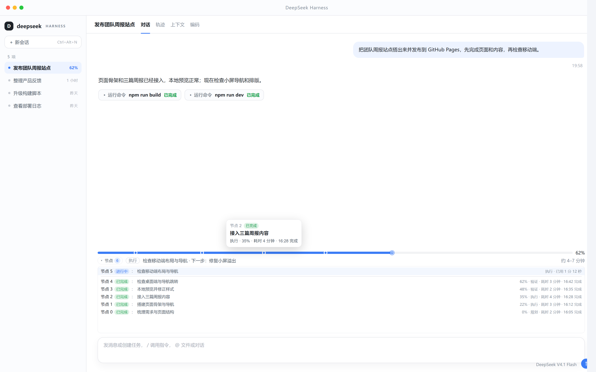
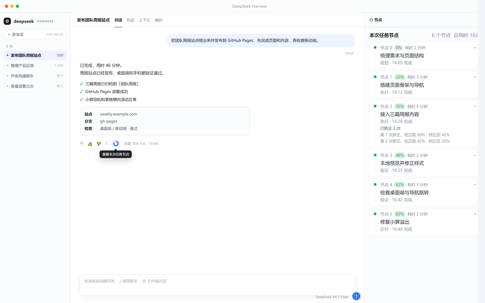

# dsh-task-progress · Session Task Progress

[中文](README.md) · English

A DeepSeek Harness (DSH) plugin that shows how far the current task has got, both in the session and on the sidebar row. Each time the model moves to a new node within the current turn, the previous node leaves a node on the progress bar.

 

## Scene previews

Two illustrations of a fictional task (no real conversation content).

**In progress:** several completed nodes and one current node on the bar; hovering a node opens its detail card, and the node list is expanded below.



**Completed:** after the reply is final, the gray node glyph in the reply footer (after the context action, before the branch) opens the Right Sidebar, which lists every node as a card in time order.



## Features

| Where | What it shows |
| --- | --- |
| Above the composer (`conversation.input.dock`) | Two rows: the first has the bar, the percentage and this turn's nodes; the second has the phase, current node, next step and estimated time left. Width follows the chat content area (the host's `--dsh-chat-content-width`) and tracks resizing |
| On the session row (`sidebar.session.row.trailing`) | A small ring and percentage next to the timestamp, colored like the bar; shown only for a running, non-empty, non-subagent session that has an estimate |
| In a completed reply's footer (`conversation.chat.assistant-actions`) | After the model's reply is final, a gray progress glyph after the context action and before the branch action; only on the latest completed turn |
| Right Sidebar (`sidebar.right.pane.tab`) | Clicking that glyph opens a **Nodes** card page: every node of the task in time order, with durations |

It appears only while a session runs and lingers briefly after it ends; history and idle sessions show nothing. The large percentage is always **this turn's** 0–100% and never accumulates across turns.

### Nodes for the current turn

Nodes belong to the current turn only and do not record earlier turns:

- Whenever model self-report or the side-channel evaluator names a new "current node", the previous node counts as finished and leaves a **filled node** at the percentage where it was last seen.
- The current node is an **outlined node** at the bar's current percentage.
- Hovering any node opens a detail card: which node, finished / in progress, its label and phase; finished nodes show the completion time and how long that segment took (from appearing to being replaced), the current node shows elapsed time and the *next step*.
- Nodes are Tab-focusable and show the same detail on focus.
- At most **100** nodes are kept per turn; older ones fade off the rail.
- Nodes are numbered from **0**: the first finished node is "Node 0", with the current node next.
- Coincident nodes are nudged apart so every one stays hoverable.
- Completed nodes stay on the rail at the percentage recorded when they closed — never spread evenly by node count. When the newest node's percentage does not rise above the previous one (≤), the Host attaches the turn's node list to its next side-channel evaluation and asks the model for the share of the current plan already completed (an anchor); the completed nodes are then rescaled onto it proportionally. Without an anchor the rail falls back to the local monotonic hold, so nodes never invert. Positions stay clamped to the bar and the current fill. The correction costs no extra request: it rides on the existing evaluator call, and only the request that detected a drop carries the node list.

The rail is maintained in the host's evaluator memory (it observes the effective node every 15 seconds), so nodes survive a page reload and reset on the next turn. When a turn ends, the last node is closed at `turn/end` and stays visible briefly.

### Node list

The leftmost control on the second row is a **Nodes** button with a count badge. Opening it expands the turn's full node list:

- the current node first (`Node N [In progress]: detail · phase · elapsed`);
- below a separator, every completed node in time order (`Node 0 [Done]: detail · phase · duration · finished at`), numbered from 0;
- the list has a **fixed 180px height** and scrolls inside itself; click the button again to collapse it. The badge is the total number of nodes this turn.

The list and the rail carry the same completed nodes.

### Simple tasks

A turn with no tool call, no `report_progress` call, and short text and duration counts as a **simple task** (defaults: at most 30 seconds, at most 1200 characters combined):

- the Host skips the side-channel evaluator: no evaluation tokens and no node rail;
- the strip shows one quiet line, `✓ Simple task, no evaluation needed`, only after the model has started answering (or the turn ends) — a slow first token no longer flashes it before switching to the progress bar;
- the sidebar ring, the footer glyph and the Nodes page stay hidden;
- a later tool call switches the turn back to normal progress automatically.

The switch and both thresholds live in **Settings → Task progress → Simple tasks**.

### Completed-task entry

Once the reply is final and this is the latest turn, the completed message's action row (`conversation.chat.assistant-actions`) shows a **gray** progress glyph after the context action and before the branch action. It is not repeated on older turns; only the latest completed turn carries it. Clicking it:

- opens the Right Sidebar on a tab named **Nodes** with the same glyph in its title;
- shows every node of `rails[sessionId]` as a card in time order: number, done/in-progress, label, phase, duration and finish time; the header carries the total;
- the Host keeps the completed turn's rail until the next turn's first observation, and the client marks the last node done as soon as `taskProgress.done` arrives, even before the next Host sweep.

The plugin icon (the one shown under Settings → Plugins) is `icon.svg`; the **Task progress** icon in the Settings navigation is registered through the `settings.section.icon` slot (same id as `settings.section`), so the Settings page shows the same glyph too.


## Where the number comes from

The evaluator is always **the session's own model**, through two channels:

1. **In-session tool `report_progress`** (preferred): `percent`, `phase` (plan / execute / verify / deliver), `milestone`, optional `next`, `eta_min`, `revised`. The tool description pins a scale: 0 not started, 25 plan settled, 50 half the work done, 75 verifying, 100 delivered and verified.
2. **Side-channel evaluator** (fallback): models often ignore such "telemetry" tools, so while a turn is open and the last self-report is stale, the host sends one short request on the session's current model route. The input is a compressed digest of **this turn only** (user request, todos, last 8 tool calls, last assistant output, minutes elapsed), capped at ~900 tokens; the output is forced to a single JSON line. Results live in memory and the page reads them every 2 seconds from a read-only route.

Merge priority: **fresh model self-report (within 3 minutes) > side-channel evaluation > todo ratio > nothing**. When none exists the bar shows "evaluating" and elapsed time instead of inventing a number. The node rail uses the same priority to pick the node on display.

## Install

Option 1 (npm, recommended — the Plugins page then offers version updates):

```text
Plugins -> Add plugin -> @deepslacker/dsh-task-progress -> pick a version -> install -> restart DSH
```

or from the profile directory:

```bash
cd C:/Users/<you>/.dsh/profiles/desktop
pnpm add @deepslacker/dsh-task-progress@latest
```

Option 2 (local directory, for development):

```text
plugin_manager action=install_bundle target=D:\DSH-workspace\dsh-task-progress
```

Option 3 (manual, in the profile directory):

```bash
cd C:/Users/<you>/.dsh/profiles/desktop
npm install "file:D:/DSH-workspace/dsh-task-progress"
# then add "@deepslacker/dsh-task-progress" to dsh.profile.bundles in package.json,
# and add a row to cordis.patch.yml:
#   - insert:
#       - id: task-progress
#         name: @deepslacker/dsh-task-progress
```

Restart the DSH desktop app afterwards to load the plugin.

### Update

When the Plugins page shows "N plugin updates available", open this plugin -> version section -> pick the new version -> update, then restart DSH. Only bundles installed from a registry get that notice; a `link:` install never does.

## Appearance

**Settings → Task progress** offers these options, applied immediately and stored in the browser's localStorage:

- Bar height: 2–24 px, default 6
- Bar color: any CSS color (`#hex`, `rgb()`, `var(--x)`); empty follows the theme accent. Also used by the sidebar ring and the nodes
- Caption font size: 9–24 px, default 12
- Node list font size: 9–24 px, default 11 (the composer's expanded list); the Right Sidebar node cards carry no fixed size and inherit the Harness theme font and size
- Simple tasks: switch, max duration, max characters (see above)

Precedence: **settings page > row config > theme default**. Row config lives in the profile's `cordis.patch.yml`:

```yaml
- id: task-progress
  name: dsh-task-progress
  config:
    barHeight: 8
    barColor: '#7c5cff'
    textFontSize: 14
    simpleMode: auto
    simpleSeconds: 30
    simpleChars: 1200
    rescore: auto
    rescoreIntervalMs: 120000
```

Other fields: `enableTool`, `minStep`, `todoBaseline`, `judge`, `judgeIntervalMs`, `simpleMode`, `simpleSeconds`, `simpleChars`, `rescore`, `rescoreIntervalMs` (reload the plugin after changing them); appearance can also be set in row config as `barHeight` / `barColor` / `textFontSize` / `listFontSize`. You can also set the CSS variables `--dtp-bar-height` / `--dtp-bar-color` / `--dtp-font-size` / `--dtp-list-font-size`. The section ends with a live preview (one completed node and the current node): hovering the bar grows it, and hovering a node opens its detail card.

## Layout

```text
dsh-task-progress/
├─ package.json       dsh manifest: bundle patch + client platform/injection order
├─ cordis.patch.yml   a single insert host row
├─ index.js           Host half: projection, side-channel evaluator, node observation, read-only route
├─ lib/progress.js    progress merging and the todo fallback
├─ lib/judge.js       evaluator digest and JSON contract
├─ lib/steps.js       node rail reducer (max 10 steps per turn)
├─ client.js          browser half: bar, nodes, sidebar ring, settings page
├─ locale/{zh,en}.json titles/descriptions shown by the plugin manager
├─ docs/              design and implementation notes
└─ test/              node --test unit tests
```

## Cost and limits

- Tool schema is about 150–200 tokens per request (`minStep` can raise it).
- Each side-channel evaluation: ~600–900 input tokens, output capped at 1.2k (usually a few dozen), at most once per 2 minutes per running session; skipped entirely while a model self-report is fresh.
- The percentage is the model's judgement, not a measurement, and may be optimistic; the scale, `revised` and the side-channel check only mitigate that. The evaluator sees this turn's digest only, not the code.

## Releases

Version history lives in [CHANGELOG.md](CHANGELOG.md). GitHub Releases are created by `.github/workflows/release.yml` when `main` is pushed:

1. Set the new version in `package.json`'s `version`.
2. Add a `## [x.y.z] - YYYY-MM-DD` section at the top of `CHANGELOG.md`, with `### Added` / `### Changed` / `### Fixed` as needed.
3. Commit and push to `main`. When the version has no `vx.y.z` release yet, the workflow creates the tag and Release from that CHANGELOG section; an unchanged version is skipped.

Manual: `gh release create vx.y.z --target <commit> --title vx.y.z --notes-file <(node scripts/changelog-section.mjs x.y.z)`.

Releases: https://github.com/DeepSlacking/dsh-task-progress/releases

## License

MIT License, Copyright (c) 2026 dsh-task-progress contributors.

Free to use, modify and redistribute under the MIT license; see [LICENSE](LICENSE) for the full text.
