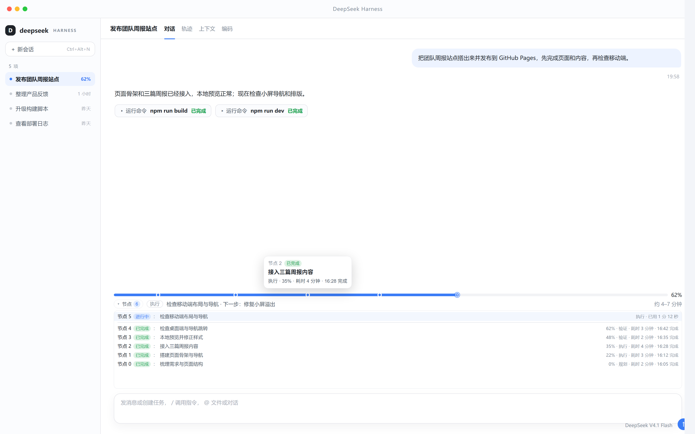
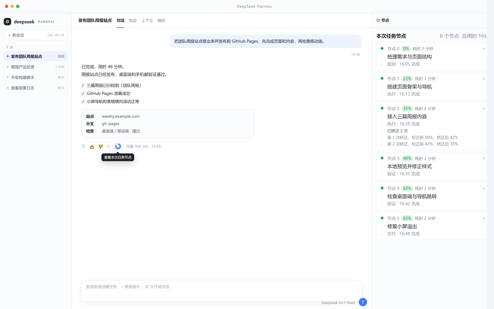

# dsh-task-progress · 会话任务进度

中文 · [English](README.en.md)

DeepSeek Harness（DSH）插件：在会话里和侧栏上显示「当前任务做到哪一步」。同一轮里模型每换一个节点，上一个节点就在进度条上留一个节点，悬停可看详情与耗时。

 

## 场景示例

两张虚构任务的界面示意（不含真实会话内容）。

**进行中的任务**：进度条上有多个已完成节点和一个进行中的节点；悬停节点显示详情卡，第二行展开节点列表。



**完成后的任务**：模型回复完成后，回复底部的灰色节点图标（排在上下文之后、分支之前）打开右侧边栏；侧栏以卡片形式按时间正序展示全部节点。



## 功能

| 位置 | 显示 |
| --- | --- |
| 输入框上方（`conversation.input.dock`） | 两行：第一行整条进度条、百分比和本轮节点；第二行阶段、当前节点、下一节点、预计剩余时间区间。宽度跟随会话内容区（宿主共享的 `--dsh-chat-content-width`），拖动宽度控制柄或缩放窗口时一起变化 |
| 会话行上（`sidebar.session.row.trailing`） | 行尾时间旁的小圆环和百分比，颜色与进度条一致；只有「运行中、非空白、非子代理、且有估算」的会话才显示 |
| 完成后的回复底部（`conversation.chat.assistant-actions`） | 模型回复完成后，在本轮最后一条回复的操作行里、上下文图标之后、分支图标之前显示灰色进度图标；只出现在最新完成的一轮 |
| 右侧边栏（`sidebar.right.pane.tab`） | 点击上面的图标打开「节点」卡片页，按时间正序显示本次任务的全部节点和耗时 |

只在会话运行中出现，结束后短暂保留；历史会话和空闲会话不显示。

### 本轮节点

进度条的大号百分比是**当前这一轮任务**的 0–100%，节点只属于这一轮，不记录前面几轮会话：

- 模型自评或旁路评估每给出一个新的「当前节点」，上一个节点就算完成，在它最后一次被看到的百分比处留一个实心节点。
- 当前节点是落在进度条当前百分比处的空心节点；悬停显示内容、阶段、已用时间和「下一步」。
- 进行中的节点带一圈缓慢扩散的脉冲光环（跟随系统的减少动态效果设置）。
- 已完成节点悬停显示：第几个节点、**最终百分比**、节点内容、阶段、完成时刻，以及**这一段耗时**（从它出现到被下一个节点替换）。
- 鼠标移到进度条上会纵向放大并带光晕，节点共用这个热区；节点也支持 Tab 聚焦查看详情。
- 本轮最多保留最近 **100 个**节点，更早的从轨道上淡出。
- 节点编号从 **0** 开始：第一个完成的节点是「节点 0」，当前节点排在其后。
- **节点 0 的百分比固定为 0%**：它出现在任何实际工作之前，当时只有任务描述。
- 节点编号来自 Host 的稳定序号（seq）：轨道只保留最近 100 个节点时编号仍连续，不会从 0 重来；节点过密时按百分比聚合成带数量的节点，悬停可查看组内成员。
- 子智能体会话同样记录轨道：宿主每 4 秒采样一次，完成后的会话会保留轨道（上限 400 个），因此打开已结束的子智能体仍能看到它的节点记录。
- 同一位置附近有多个节点时会左右错开，保证每一个都能悬停查看。
- 节点位置取该节点最后一次被看到时的百分比，不按节点数量均分。出现「新节点的百分比不高于上一节点（≤）」时，宿主会在下一次旁路评估里附上本轮节点列表，请模型给出「已完成部分占当前计划的百分比（anchor）」，再把历史节点按比例缩放到这个锚点；没拿到锚点时退回本地保护（后完成的节点停在上一个节点之后并铺开），因此节点永远不会反向排列。所有已完成节点都保留在轨道上，位置只限制在进度条和当前填充范围内。位置修正不会额外发起请求：它复用既有的旁路评估调用，只有检测到回调的那一次请求会带上节点列表并稍微变大。

轨道由宿主在旁路评估器的内存里维护（每 15 秒观察一次有效节点），刷新页面后节点仍在；换到下一轮时自动清空。一轮结束时最后一个节点会在 `turn/end` 处收尾，并短暂保留。

### 节点列表

第二行最左侧有一个带数量角标的「节点」按钮，点开后展开本轮所有节点的列表：

- 第一行是当前正在进行的节点（`节点 N [进行中]：详情 · 阶段 · 已用时间`）；
- 分隔线以下按时间正序列出所有已完成节点（`节点 0 [已完成]：最终百分比 · 详情 · 阶段 · 耗时 · 完成时刻`），编号从 0 开始；列表只显示最终矫正后的百分比；
- 列表**固定 180px 高**，超出时在列表内部滚动，再次点击按钮收起；角标是本轮节点总数。

列表包含所有已完成节点，与轨道上的节点一一对应。

### 完成后的节点入口

模型回复完成、且这一轮就是最新一轮时，最后一条回复底部的操作行（`conversation.chat.assistant-actions`）会在上下文图标之后、分支图标之前显示一个**灰色**进度图标；它不是每轮历史回复都出现，只跟随最新完成的一轮。点击后：

- 右侧边栏打开，标签页叫「节点」，标题带同一个进度图标；
- 页面以**节点卡片**按时间正序展示 `rails[sessionId]` 里的全部节点：编号、**百分比标签**（进行中的卡片显示「进行中」）、节点内容、阶段、耗时和完成时刻；顶部显示节点总数和任务总用时（只显示实际用到的单位，如 `14分51秒`、`1时14分51秒`）；点击已完成的卡片可展开纠正记录——未纠正显示「无需矫正」，纠正过则显示「已矫正 N 次」并逐行列出「第 X 次矫正，校正前 A%，矫正后 B%」；
- 宿主保留已完成轮次的轨道，直到下一轮第一次观察时替换；客户端在收到 `taskProgress.done` 后即使宿主还没跑下一趟清扫，也会把最后一个节点按已完成显示。

插件图标（设置 → 插件里的图标）是 `icon.svg`；设置导航里的「任务进度」图标通过 `settings.section.icon` 槽（id 与 `settings.section` 相同）注册同一套路径，所以设置页左侧也显示这个进度字形。


### 简单任务

没有工具调用、模型也没有调用 `report_progress`、且用户消息与最终回复都很短的轮次会被判定为**简单任务**（默认：用时 ≤ 30 秒、字符合计 ≤ 1200）：

- 宿主跳过旁路评估器，不消耗评估 token，也不建节点轨道；
- 输入框上方只显示一行小字 `✓ 简单任务，无需评估`；只有模型已经开始回复（或本轮结束）后才会出现——首 token 慢的时候不会先闪一下「简单任务」再切回进度条；
- 会话行圆环、回复底部节点图标、右侧节点页都不显示；
- 之后一旦出现工具调用，自动切回普通进度模式。

开关与阈值在 **设置 → 任务进度 → 简单任务**：启用/关闭（`auto` / `off`）、最长用时（秒）、最长字符数。

## 进度是怎么来的

评估者始终是**该会话自己的模型**，两条通道：

1. **会话内自评工具 `report_progress`**（首选）：`percent`、`phase`（plan / execute / verify / deliver）、`milestone`、可选的 `next`、`eta_min`、`revised`。工具描述里写死了标尺：0 未开始、25 计划确定、50 核心工作完成一半、75 主体完成并在验证、100 已交付并验证。
2. **旁路评估器**（兜底）：模型经常不调这类「遥测」工具，所以当某一轮开着而上次自评已过期时，宿主用该会话当前的模型路由发一次短请求——输入是**只属于当前这一轮**的压缩摘要（用户请求、待办、最近 8 次工具调用、最后一段助手输出、已用分钟数），上限约 900 tokens；输出强制成一行 JSON。结果存在内存，页面每 2 秒从只读路由取一次；节点轨道也随这个路由下发。

合并优先级：**模型自评（3 分钟内新鲜）> 旁路评估 > 待办比例 > 无**。三者都没有时显示「评估中」和已进行时间，而不是编一个数；节点轨道也按同一优先级取当前正在显示的节点。被判定为简单任务的一轮直接跳过旁路评估。

摘要按 `turn/start` / `turn/end` 切分，继续会话时不会把上一轮的请求或「下一步」带进新任务。

## 安装

方式一（npm，推荐；装上后插件页会提示新版本）：

```text
插件 → 添加插件 → 输入 @deepslacker/dsh-task-progress → 选择版本 → 安装 → 重启 DSH
```

或在 profile 目录用命令行装：

```bash
cd C:/Users/<you>/.dsh/profiles/desktop
pnpm add @deepslacker/dsh-task-progress@latest
```

方式二（本地目录，开发时用）：

```text
plugin_manager action=install_bundle target=D:\\DSH-workspace\\dsh-task-progress
```

方式三（profile 目录手动安装，没有 pnpm 时）：

```bash
cd C:/Users/<you>/.dsh/profiles/desktop
npm install "file:D:/DSH-workspace/dsh-task-progress"
# 再把 "@deepslacker/dsh-task-progress" 加进 package.json 的 dsh.profile.bundles，
# 并在 cordis.patch.yml 加一行（name 必须与 package.json 的包名一致）：
#   - insert:
#       - id: task-progress
#         name: '@deepslacker/dsh-task-progress'
```

包名是 `@deepslacker/dsh-task-progress`；`cordis.patch.yml` 的 name、`client.js` 里 `__ModuleLoader__.load` 的 id 都必须与它一致。安装后重启 DSH 桌面端加载插件。

### 更新

插件页顶部出现「有 N 个插件可更新」时，打开本插件 → 版本区块 → 选新版本 → 更新，然后重启 DSH。只有从 npm 源安装的组合包会收到这个提示；`link:` 本地目录安装不会。

## 外观配置

**设置 → 任务进度** 里几项，改完立即生效，保存在本机 localStorage：

- 进度条高度：2–24 px，默认 6
- 进度条颜色：任意 CSS 颜色（`#hex`、`rgb()`、`var(--x)`），清空跟随主题强调色；同时用于侧栏圆环和节点
- 说明文字字号：9–24 px，默认 12
- 节点列表字号：9–24 px，默认 11（指输入框上方的展开列表）；右侧边栏的节点卡片不设固定字号，直接跟随 DSH 主题字体与大小
- 节点大小：4–16 px，默认 6；节点始终在轨道垂直居中，小于进度条高度时位于进度条内部
- 节点颜色：已完成节点的边缘/中心、进行中节点的边缘/中心，共四项；已完成节点中心与进行中节点边缘默认与进度条同色（设置里会用色块显示当前进度条颜色），其余留空时跟随背景色
- 简单任务：启用/关闭、最长用时、最长字符数（见「简单任务」）

优先级：**设置页 > 行配置 > 主题默认**。行配置写在 profile 的 `cordis.patch.yml`：

```yaml
- id: task-progress
  name: 'dsh-task-progress'
  config:
    barHeight: 8
    barColor: '#7c5cff'
    textFontSize: 14
    simpleMode: auto
    simpleSeconds: 30
    simpleChars: 1200
    rescore: auto
    rescoreIntervalMs: 120000
```

其余字段：`enableTool`、`minStep`、`todoBaseline`、`judge`、`judgeIntervalMs`、`simpleMode`、`simpleSeconds`、`simpleChars`、`rescore`、`rescoreIntervalMs`（改完需在「插件」里重载）；外观也可在行配置里写 `barHeight` / `barColor` / `textFontSize` / `listFontSize`。也可直接设 CSS 变量 `--dtp-bar-height` / `--dtp-bar-color` / `--dtp-font-size` / `--dtp-list-font-size`。设置页底部有实时预览（一个完成节点和一个当前节点）：预览条悬停会放大，移入节点会弹出详情卡。

## 目录

```text
dsh-task-progress/
├─ package.json        dsh 清单：bundle patch + client 平台/注入顺序
├─ cordis.patch.yml    一条 insert 宿主行
├─ index.js            Host 半：投影、旁路评估、节点轨道、只读路由
├─ lib/progress.js     进度合并、待办兜底
├─ lib/steps.js        本轮节点轨道的纯 reducer（标签变化 → 关闭上一步）
├─ lib/judge.js        旁路评估摘要与 JSON 契约
├─ client.js           浏览器半：进度条、节点、侧栏圆环、设置页
├─ locale/{zh,en}.json 插件管理器显示用的标题/描述
├─ docs/               详细设计与实现说明
└─ test/               node --test 单元测试
```

## 成本与限制

- 工具 schema 约 150–200 tokens/请求（`minStep` 可调高）。
- 每次旁路评估：输入约 600–900 tokens，输出上限 1.2k（实际几十个），每个运行中的会话最多每 2 分钟一次；模型自评新鲜时完全跳过。
- 百分比是模型的判断而非测量，可能偏乐观；标尺、`revised` 和旁路复核只能缓解。旁路评估只看当前轮摘要，不知道代码细节。
- 节点耗时是**观察区间**（宿主每 15 秒观察一次），分辨率是十几秒；旁路评估换一种措辞描述同一件事时会多出一个内容相近的节点。
- 轨道只存在宿主内存里，DSH 重启后从当前节点重新开始；投影和自评仍在会话日志里。

## 发布 / Releases

版本记录在 [CHANGELOG.md](CHANGELOG.md)，GitHub Releases 由 `.github/workflows/release.yml` 在推送到 `main` 时自动创建：

1. 把 `package.json` 的 `version` 改成新版本号；
2. 在 `CHANGELOG.md` 顶部加 `## [x.y.z] - YYYY-MM-DD` 段，按需写 `### Added` / `### Changed` / `### Fixed`；
3. 提交并推送到 `main`。工作流发现该版本还没有 `vx.y.z` Release 时，会用 CHANGELOG 的对应段落创建 tag 和 Release；版本号没变则自动跳过。

也可以手动创建：`gh release create vx.y.z --target <commit> --title vx.y.z --notes-file <(node scripts/changelog-section.mjs x.y.z)`。

Releases 页：https://github.com/DeepSlacking/dsh-task-progress/releases

## 许可

MIT License，Copyright (c) 2026 dsh-task-progress contributors。

本插件在 MIT 许可下自由使用、修改与分发；完整条款见 [LICENSE](LICENSE)。
