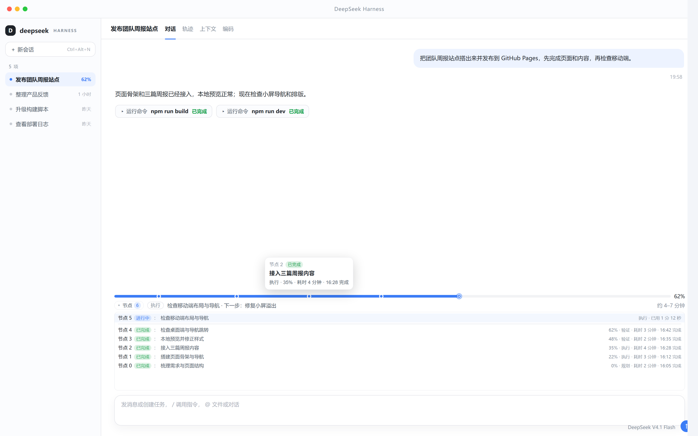
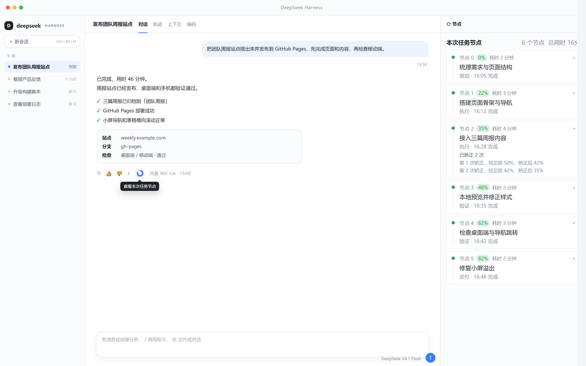

# Task progress

Shows, in the conversation and the sidebar, how far the running task has got: the bar, the turn's nodes, the current node and next step, the remaining-time range, and the finished node history.

## Where it appears

- **Above the composer** (`conversation.input.dock`): two rows. The first carries the bar, its percentage and the turn's nodes; the second carries the phase, the current node, the next step and the remaining-time range. It appears only while the session runs and lingers briefly after the turn ends.
- **On the session row** (`sidebar.session.row.trailing`): a small ring and percentage, only for a running, estimated, non-subagent session.
- **In a finished reply** (`conversation.chat.assistant-actions`): after the latest turn finishes, a grey progress glyph sits after the context action and before the branch action; it opens the Right Sidebar.
- **Right Sidebar** (`sidebar.right.pane.tab`): the turn's node cards in time order.

## Where the progress comes from

- The session's own model can call `report_progress` when it finishes a node: percentage, phase, current node, next step, remaining estimate.
- When it does not, the Host runs a side-channel evaluation every 4 s (the same model, rate-limited by `judgeIntervalMs`) and fills in the missing nodes.
- While neither has produced a result the strip stays hidden — it never guesses or flashes.

The large percentage is always the **open turn's own 0–100%**; it does not accumulate across turns.

## Nodes for the turn

- When a new node appears, the previous one leaves a filled node at the last percentage it was seen at; the current node is the outlined node at the current percentage, carrying a slow pulse ripple.
- Hovering a node shows its number, final percentage, text, phase, duration (or elapsed time) and finish time.
- Node numbers are assigned by the Host and keep increasing: the rail keeps only the newest 100 nodes, but numbers never restart after 100. Node 0 is fixed at 0% — it exists before any real work.
- Crowded nodes are grouped into counted nodes by percentage; hovering lists the members, and dots never leave the rail.
- The "节点 N" button on the second row expands the list: the current node first, then the finished nodes in time order (number, percentage, phase, duration, finish time); the list is 180 px tall and scrolls internally.
- Node appearance is configurable in **Settings → Task progress**: node size 4–16 px and four colors — finished edge/center and running edge/center. The finished center and running edge follow the bar color by default.

## History rescales and corrections

- When a new node's percentage is not higher than the previous one, the Host asks the evaluator for an anchor and rescales the history proportionally (rate-limited to one attempt per 120 s) so the rail stays monotonic.
- Each rescale is recorded per node: the original percentage, the correction count, and every "before → after" pair.
- Expanding a finished card in the Right Sidebar shows "无需矫正" when nothing moved it, or "已矫正 N 次" followed by one line per correction.

## Right Sidebar

- Header: node count and the task's total duration. The duration uses only the units actually used (for example `14分51秒`, `1时14分51秒`), comes from the rail's own start/end clock, is fixed once the turn ends, and is hidden when there is no rail.
- Cards: node number, final-percentage badge, duration, text and finish time; expanding a finished card reveals its correction history.
- Card colors and percentage badges share the strip's theme.

## Subagents

- Subagent sessions record a rail too. The Host samples every 4 s and keeps finished sessions' rails (up to 400), so opening a finished subagent still shows the nodes it recorded.

## Simple tasks

A turn with no tool calls, no node reports, and elapsed time and character count below the thresholds is treated as a simple task: no evaluator call and no strip, just one quiet line "简单任务，无需评估" once the model starts answering. The thresholds live in **Settings → Task progress → Simple tasks**.

## Known limits

- Rails live in Host process memory: a page refresh keeps them, but after DSH restarts the nodes of earlier turns are gone.
- A turn keeps its newest 100 nodes (stable numbers and the total are unaffected); older nodes are no longer drawn individually.
