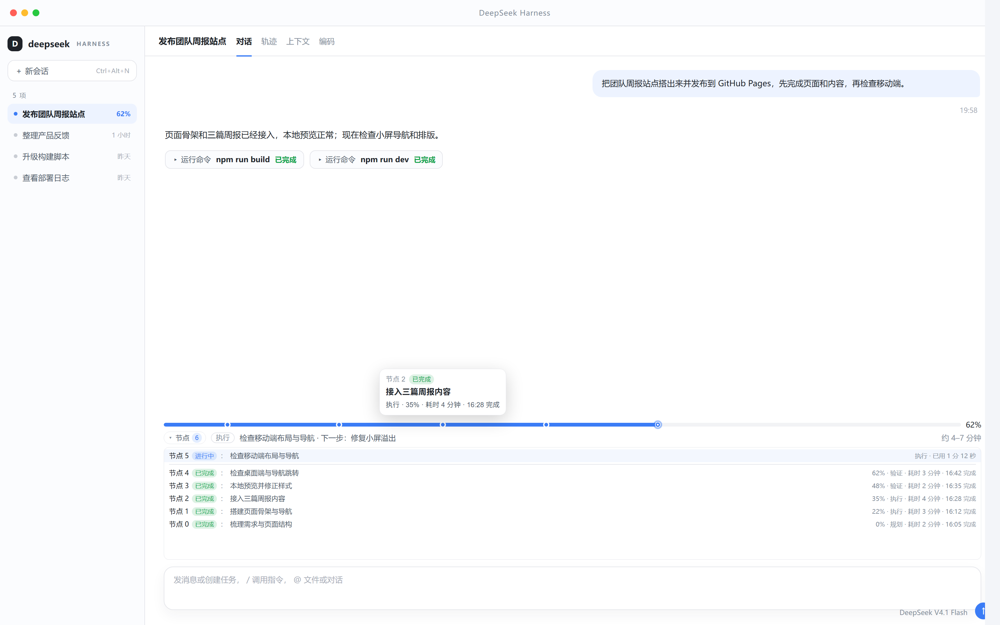
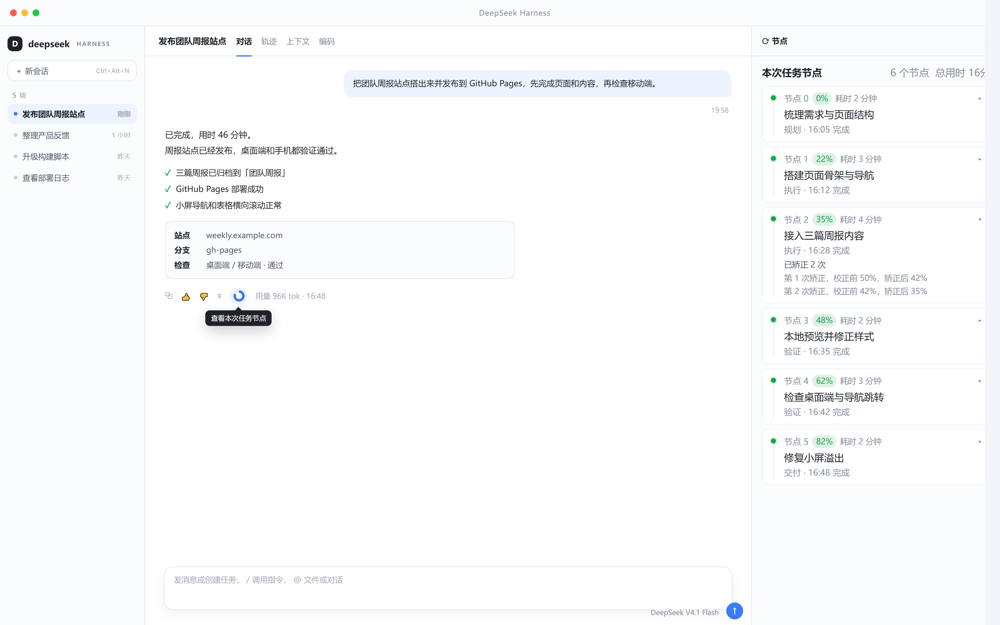

# 任务进度

在会话里和侧栏上显示「当前任务做到哪一步」：进度条、本轮节点、当前节点与下一步、预计剩余时间，以及完成后的节点历史。

## 显示位置

- **输入框上方**（`conversation.input.dock`）：两行。第一行是进度条、百分比和本轮节点；第二行是阶段、当前节点、下一步和预计剩余时间区间。只有运行中的会话出现，回合结束后短暂保留。
- **会话行尾**（`sidebar.session.row.trailing`）：小圆环 + 百分比，仅在运行中、有估算、非子智能体的会话显示。
- **回复底部**（`conversation.chat.assistant-actions`）：最新一轮回复完成后，在上下文图标之后、分支之前出现灰色进度图标；点击打开右侧边栏。
- **右侧边栏**（`sidebar.right.pane.tab`）：本轮节点卡片，按时间正序排列。

## 进度从哪来

- 会话内的模型在完成节点时调用 `report_progress` 自评：百分比、阶段、当前节点、下一步、预计剩余时间；
- 模型不调用时，宿主每 4 秒做一次旁路评估（同一模型，受 `judgeIntervalMs` 限流），用补位估算生成节点；
- 两者都还没有结果时，进度条保持隐藏，不闪烁、不猜测。

进度条的大号百分比始终是**当前这一轮**的 0–100%，不跨轮累计。

## 本轮节点

- 新节点出现时，上一个节点在它最后一次被看到的百分比处留下一个实心节点；当前节点是空心节点，落在当前百分比处，并带缓慢脉冲光环。
- 悬停节点显示：节点序号、最终百分比、内容、阶段、耗时（或已用时间）和完成时刻。
- 节点序号由宿主分配并单调递增：轨道只保留最近 100 个节点，但序号继续增长；超过 100 时编号不会重启。节点 0 固定为 0%——它出现在实际工作开始之前。
- 节点过密时按百分比聚合成带数量的节点，悬停可列出组内成员，节点不会被挤出进度条。
- 第二行的「节点 N」按钮展开列表：第一行是当前节点，下面按时间正序列出已完成节点（编号、百分比、阶段、耗时、完成时刻）；列表固定 180px 高，可在内部滚动。
- 节点外观可在 **设置 → 任务进度** 调整：节点大小 4–16px；已完成节点的边缘/中心、进行中节点的边缘/中心共四种颜色。已完成中心与进行中边缘默认与进度条同色。

## 历史缩放与矫正记录

- 新节点的百分比不高于上一个节点时，宿主会向评估器请求一个锚点，按比例缩放历史节点（每 120 秒限流一次），让轨道保持单调递增。
- 每次缩放都会记录：节点保留原始百分比、矫正次数，以及每一次矫正的「校正前 → 校正后」。
- 在右侧边栏展开已完成卡片：未矫正显示「无需矫正」，矫正过显示「已矫正 N 次」并逐行列出每一次矫正。

## 右侧边栏

- 顶部：节点数与任务总用时。总用时只显示实际用到的单位（如 `14分51秒`、`1时14分51秒`），按轨道自身的开始/结束时间计算，完成后固定；没有轨道时不显示。
- 卡片：节点序号、最终百分比徽标、耗时、详情与完成时刻；点击已完成的卡片可展开矫正记录。
- 卡片颜色、百分比徽标与进度条保持同一套主题。

## 子智能体

- 子智能体会话同样记录轨道；宿主每 4 秒采样一次，并保留已完成会话的轨道（上限 400 个），因此打开已结束的子智能体仍能看到它记录的节点。

## 简单任务

没有工具调用、没有节点上报、且用时与字数都在阈值内的轮次按简单任务处理：不调用评估器、不显示进度条，只在模型开始回复后显示一行「简单任务，无需评估」。阈值在 **设置 → 任务进度 → 简单任务**。

## 已知限制

- 轨道保存在宿主进程内存里：刷新页面不丢，重启 DSH 后历史轮次的节点不再显示；
- 每轮最多保留最近 100 个节点（稳定序号与总数不受影响），更早的节点不再单独绘制。
